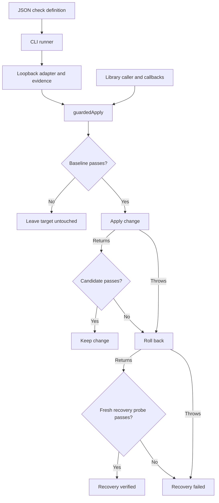

# Agent Guard

A site edit silently broke contact-form delivery. The form still showed a success message, but enquiries never reached the inbox and were lost.

Agent Guard verifies the original behavior, applies the edit, and verifies again. If the check fails, it rolls back the edit and sends a fresh probe to confirm recovery.

## Run the local demo

Use Node.js 22.18 or later. Install dependencies once with `npm ci`, then run the demo.

```sh
npm run demo
```

The demo applies a bundled edit that stops enquiry emails. The terminal output below is from one run. Each submission gets a new reference.

```text
Checking baseline delivery before applying bundled-broken
baseline (01ece868-fdb7-4ad3-b9b7-7b0424c400eb): form reported success; matching email received
Applied bundled-broken
with-company (e5eca5a2-22a3-4b06-83c3-458dbea64a30): form reported success; No matching email within 1500 ms (e5eca5a2-22a3-4b06-83c3-458dbea64a30)
without-company (6dcf0f48-1c05-4485-bb87-7828f646008a): form reported success; No matching email within 1500 ms (6dcf0f48-1c05-4485-bb87-7828f646008a)
Edit rejected. Original form restored. Checking recovery.
recovery (a820ae9b-8019-484c-b054-14694b9d355b): form reported success; matching email received
EDIT REJECTED — RECOVERY VERIFIED
```

Progress goes to stderr. Use `npm run --silent demo` for the JSON report on stdout.

| Exit | Outcome |
| --- | --- |
| 0 | Edit accepted or standalone baseline verified |
| 1 | Baseline broken |
| 2 | Edit rejected and recovery verified |
| 3 | Edit rejected and recovery failed |
| 4 | Invalid proposal |
| 5 | Provider error |
| 64 | Invalid command or demo arguments |

Invalid arguments to the standalone `baseline` command also exit with `2`.

## Recorded live walkthrough

The recorded OpenAI run used `gpt-6-luna`. The task was to add an optional Company field and append Company to the email fields.

The proposal kept the original fields and email order. It appended `{"name":"company","required":false}` to the form fields and `"company"` to the email fields.

| Submission | Reference | Local inbox evidence |
| --- | --- | --- |
| Original form | `bca2f805-581d-454c-b937-d35ce03583a1` | Matching enquiry email received |
| Edited form with Company | `b1a89aa4-e237-41c7-bde6-0b268cfab400` | Matching email included `Company: Example Studio` |
| Edited form without Company | `79d240f8-dc61-47fc-b0a5-8a04c7af850b` | Matching email had no Company line |

The guard kept the edit and reported **EDIT ACCEPTED** with exit status `0`. [Read the recorded JSON report](docs/live-run.json).

## Webhook retries

```sh
npm run --silent webhook
```

The proposed edit adds a second webhook event type. The guard sends event A, retries A, and sends a distinct event B for the same lead. All requests return HTTP 204, but the bundled edit writes three ledger entries where two are expected. The guard restores the original definition and verifies it with fresh events. The default exits with status `2`.

Use `-- --scenario valid` to keep the edit or `-- --scenario suppress-distinct` to see a definition that loses B instead. The JSON report includes the acknowledgements and expected and observed event IDs. [Recorded webhook run](docs/webhook-run.json)

## Contact conversions

```sh
npm run --silent conversion
```

The guard submits two enquiries and withholds mail for one. Both forms report success. The bundled edit records two conversions, but only one has a matching inbox receipt. The guard restores the original form behavior and verifies it with a fresh enquiry. The default exits with status `2`.

Use `-- --scenario valid` to keep the edit that records only the delivered enquiry. The JSON report shows each confirmation and email, along with the conversion references observed by a local collector.

## Form redirects

```sh
npm run --silent redirect
```

The original temporary redirect uses HTTP 307. The bundled edit makes it permanent with HTTP 301. Node's Fetch follows that redirect as GET, and the destination receives an empty body. The guard restores the 307 and verifies a fresh POST with its original form body. The default exits with status `2`.

Use `-- --scenario valid` to keep a permanent HTTP 308 redirect that preserves the POST and body. The JSON report shows the status, method, and body for each check. [HTTP redirect semantics](https://www.rfc-editor.org/rfc/rfc9110.html#section-15.4)

## Evaluate a live proposal

Set `OPENAI_API_KEY` in your shell environment, then run:

```sh
npm run --silent demo -- --live
```

After verifying baseline delivery, Agent Guard sends the synthetic task and form definition to OpenAI in one request to GPT-6 Luna. The request uses your API account. The guard reports the first outcome and runs the same local delivery and recovery checks for a valid proposal. Provider or credential errors exit with status 5. The JSON report identifies the model and includes the proposal when it passes form-definition validation.

CI uses a local provider stub for the live path. It needs no OpenAI credentials.

## Guard your own change

Run `npm pack` in this repository. Install the resulting `.tgz` file in your Node project, then import `guardedApply`. The library runs your callbacks and returns a typed outcome.

```ts
import { guardedApply } from 'agent-guard';

const original = 'current release';
let active = original;

const result = await guardedApply({
	baseline: () => active === original,
	apply: () => { active = 'proposed release'; },
	verify: (stage) => active === (stage === 'candidate' ? 'proposed release' : original),
	rollback: () => { active = original; },
});

console.log(result.outcome);
```

This example prints `accepted`. For a real deployment, capture the rollback state before applying the change. Use fresh probes in `verify`. If `apply` throws, the library calls `rollback` because part of the target may have changed. A rollback counts as recovered only after the recovery probe passes.

## Verify baseline delivery

```sh
npm run baseline
```

The command starts a fresh contact site and SMTP server on loopback, submits a synthetic enquiry, and exits with `0` when the inbox contains the matching email. After setup, it needs no internet connection or credentials.

```sh
npm run baseline -- --simulate-no-delivery
```

This scenario delivers an older enquiry first. The next submission shows the same success response but sends no email. The command prints `BROKEN BASELINE` and exits with `1` once the 1.5-second delivery window expires. Each run discards its inbox and closes both local servers.

## Architecture



The CLI adapters collect evidence from the local inbox, webhook ledger, conversion collector, or redirect destination. The library runs the same lifecycle with callbacks you supply.

## How to add a check

The [temporary redirect example](checks/redirect-temporary.json) changes a permanent HTTP 308 redirect to a temporary HTTP 307. It also tries HTTP 301 to exercise rollback.

1. Copy `checks/redirect-temporary.json` to `checks/redirect-copy.json`. The file name without `.json` is the CLI command. Use lowercase letters, numbers, and hyphens, start with a letter, and reserve `baseline` for the standalone command.
2. Set `adapter` to `mail`, `webhook`, `conversion`, or `redirect`. For a redirect, set `settings.baselineStatus` and `settings.candidateStatus` to the redirect statuses you expect. The adapter also checks that the destination receives the original POST and body.
3. Add scenarios with a `proposal` and an `expect` value. Use `accepted`, `brokenBaseline`, `recovered`, `recoveryFailed`, or `invalid` for the offline adapters. Set `default` to the scenario the CLI should run without a flag. Use `fault` with `baseline` or `recovery` to inject a failure at that stage.
4. Run `node src/cli.ts redirect-copy` to see the check accept the 307. Run `node src/cli.ts redirect-copy --scenario loses-body` to see the original 308 restored and recovery verified.

Run `npm test` to check the CLI and library. It discovers additional check files automatically. Run `npm run eval` to print and regenerate the [scenario results](docs/eval.md). The saved live run is included as historical evidence.

## Limitations

- The bundled adapters use synthetic fixtures on `127.0.0.1`. Each run discards its local state when it exits. Only the optional `--live` demo requests a proposal from a remote service.
- A check file selects an existing adapter. To check a different kind of system, supply your own callbacks to `guardedApply`.
- Your callbacks own the snapshot, target permissions, timeouts, and write coordination. A process crash can interrupt recovery. A rollback cannot recover an enquiry that was already lost.
- The live report records one proposal. It provides no estimate of model reliability.

## What's next

Add a staging deployment example with a persistent snapshot and an independent health check. An MCP wrapper could expose that specific guarded deployment to an agent.
